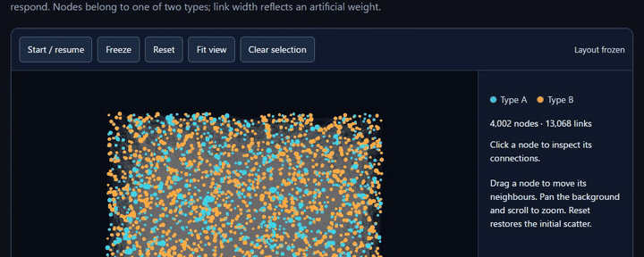

# Who Falls Next

**Who connects to whom, and who would feel it if one node fell?**

A browser-based map of a bipartite network with live GPU force layout, built for network-analytics and graph-analytics audiences.

> Live demo: https://igel7.github.io/network-portfolio/ (layout, dragging, selection and stress propagation)

## What it shows

- **Now: explore the network.** Start the force layout and watch nodes of two types settle. Drag a node and its neighbours respond through the simulation.
- **Now: failure impact.** Click a node and follow a stylised stress propagation round by round, with the impact share and the ten most affected nodes. Node size shows a stylised impact score once computed.
- **Planned: hidden groups.** Find groups of nodes whose neighbours overlap more than node degrees would predict.

## Data

The network is **anonymised bipartite-network connectivity with artificial link weights**. Identifiers are replaced with surrogates; link weights are sampled independently from a fitted distribution and are not the source values. No real names, source identifiers, dates or source values appear. The data source is not disclosed. Any propagation model is **stylised** and illustrative only.

## How it is built

- Rendering and GPU layout engine: [cosmos.gl](https://github.com/cosmograph-org/cosmos) (MIT).
- Everything else is mine: data preparation, modelling, analysis design and the interface.
- Python prepares the data offline; the browser runs the layout and rendering. Static hosting on GitHub Pages. Requires WebGL; WebGPU is not needed.

## Repository layout

- `site/` static site shell (Vite + TypeScript). See `site/README.md` for build steps.

## Author

Ryotaro Yasui · [GitHub](https://github.com/igel7) · [LinkedIn](https://www.linkedin.com/in/ryotaro-yasui-778220334)

## Licence

All rights reserved. The source is published for review only. No part of this repository may be copied, reused or redistributed without written permission. cosmos.gl is used under its MIT licence; see `site/public/licenses/`.
